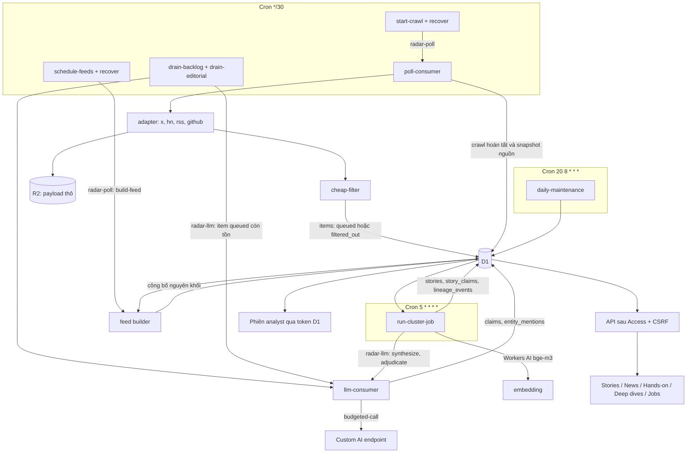

# Kiến trúc

Tài liệu này giải thích hệ thống hoạt động thế nào và vì sao. Chi tiết schema nằm trong [`apps/worker/migrations/`](../apps/worker/migrations/), tham số thuật toán nằm trong [`packages/core/src/params.ts`](../packages/core/src/params.ts); tài liệu này không chép lại chúng.

## Luồng dữ liệu



Một Worker duy nhất xử lý `fetch`, `scheduled` và `queue`, và phục vụ luôn bản build tĩnh của giao diện. Nhờ vậy chỉ có một lần deploy và một hostname để che bằng Access.

## D1 là sổ cái, queue chỉ là tín hiệu đánh thức

Queues giao message ít nhất một lần, chỉ giữ 14 ngày, và message hết hạn thì biến mất chứ không vào dead-letter. Vì vậy không công việc nào chỉ tồn tại trong queue:

- Item mới được ghi **cùng trạng thái cuối của nó** (`queued` kèm `queued_at`, hoặc `filtered_out` kèm lý do) trong một câu lệnh, rồi message mới được gửi. Consumer chết giữa chừng thì item vẫn nằm đó ở trạng thái `queued`.
- Ưu tiên bóc claim cho bài trong cửa sổ gom nhóm hiện tại (mặc định 7 ngày, cùng `core_overrides.windowDays` với cluster). Crawl lưu bài cũ vào D1/R2 và dừng sau chống trùng; bài mới thuộc crawl đang chạy chờ crawl hoàn tất rồi mới được rút backlog. Bài đã thuộc crawl hoàn tất trước đó vẫn được xử lý khi crawl tiếp theo chạy. Đường poll cũ không có crawl ID giữ hành vi đánh thức ngay bài trong cửa sổ. Backfill thủ công vẫn gửi message theo hợp đồng hiện có.
- Mỗi 30 phút `drain-backlog` gửi lại message cho các item `queued` có lần đánh thức gần nhất quá 30 phút, trong phạm vi ngân sách còn lại của ngày. Khi còn bất kỳ bài trong cửa sổ đang `queued`, chỉ nhóm này được gửi và xử lý, kể cả khi chúng đang chờ retry; message bài cũ có sẵn trong queue được ack để chờ trong D1, không tốn lượt AI hay retry. Khi nhóm mới hết, bài cũ tự được xử lý tiếp. Trong mỗi nhóm ưu tiên, item trực tiếp trước item backfill, cũ nhất trước. Nếu bài mới đến liên tục vượt khả năng AI thì bài cũ có thể chờ lâu; dữ liệu không bị xoá hay đổi chế độ ingest.
- Bộ đếm giới hạn 20 lần xử lý item chỉ tăng khi nhận được output hoặc request bị từ chối; chờ ngân sách, lỗi cấu hình, mạng, output trống/cắt và chờ bài mới không bị tính. Request/shape bị từ chối vẫn theo đường chia đôi lô để cô lập item lỗi.
- Message `extract` của item không còn `queued` được ack mà không gọi LLM. Nhờ đó message giao trùng hay một lô bị phát lại đều vô hại; khoá `(item_id, content_hash)` chặn claim trùng.
- Crawl ghi danh sách nguồn vào D1 trước khi gửi queue. Chỉ có một crawl đang chạy; mỗi nguồn có token và lease 15 phút. Cron gửi lại việc bị mất hoặc hết lease, tối đa sáu lần nhận việc trước khi ghi lỗi. Crawl chỉ kết thúc khi mọi nguồn đã thành công hoặc thất bại; lỗi một phần có trạng thái `partial`.

Lưu ý khi sửa code ghi dữ liệu: dùng `ON CONFLICT (...) DO NOTHING` trên đúng khoá, không dùng `INSERT OR IGNORE`. `OR IGNORE` của SQLite nuốt cả vi phạm `CHECK`, tức một claim sai định dạng sẽ biến mất trong im lặng.

## Crawl và các feed editorial

Schema mở rộng ở [`0010_editorial_feeds.sql`](../apps/worker/migrations/0010_editorial_feeds.sql); điều phối ở [`jobs/`](../apps/worker/src/jobs/) và dựng nội dung ở [`feeds/`](../apps/worker/src/feeds/). Crawl không gọi AI hoặc dựng feed. Mỗi feed có lịch riêng trong D1; cron 30 phút kiểm tra các lịch đến hạn. Mặc định News mỗi 60 phút, Hands-on và Deep dives mỗi 1.440 phút. Nút Build/Rerun chọn một crawl `ok`/`partial` và không crawl lại nguồn.

`crawl_items` đóng băng nội dung tối đa 6.000 ký tự, số liệu, nguồn và thời điểm quan sát. Khi dựng feed, lấy bản quan sát thành công gần nhất của mỗi item từ crawl được chọn trở về trước, trong cửa sổ 7/30/90 ngày tương ứng. Metadata editorial phải khớp hash nội dung; claim phải có quote khớp bản nguồn đã đóng băng. Build dùng kết quả phân tích và đồ thị Stories hiện có tại thời điểm dựng, nên chạy lại có thể bổ sung nội dung vừa phân tích xong. Build không gọi LLM. Bản đã công bố không thay đổi khi nguồn hoặc phân tích được cập nhật sau đó.

Mỗi feed chỉ có một build đang chờ/chạy. `feed_entries` dàn dựng theo lô; con trỏ `feed_publications` và trạng thái `done` chuyển trong cùng transaction, có token/lease chống worker cũ công bố. Build lỗi giữ nguyên con trỏ trước đó. Intent vẫn ở D1 nếu gửi queue thất bại, và cron khôi phục. Dữ liệu crawl/build hiện được giữ làm lịch sử; cần theo dõi dung lượng D1 khi vận hành dài ngày.

- **News:** dùng nhóm và điểm Stories hiện có; ngưỡng mặc định 55, không đổi công thức Stories. Recent là 24 giờ, Last 7d là 7 ngày tính lúc đọc. Đếm tác giả chuẩn, nền tảng, bài và tương tác một lần mỗi item trong câu chuyện; chỉ hiện findings thuộc câu chuyện đó. Tương tác cộng các số thực có từ nguồn, không coi star GitHub là tương tác xã hội. Vai trò lab leader chỉ đếm `labLeaderAuthorKeys` được khai báo; danh sách trống hiển thị chưa gắn vai trò.
- **Hands-on:** Community toolbox lấy repository thật hoặc bài phân loại `tool`; Field tests đòi claim trải nghiệm/đo đạc trực tiếp có quote hợp lệ; Playbooks lấy quy trình được phân loại `playbook`. Phân trang sáu thẻ. GitHub Search chỉ là discovery; hạng và star/ngày lấy từ [GitHub Trending](https://github.com/trending?since=daily). Facts bổ sung dùng [Repository API](https://docs.github.com/en/rest/repos/repos?apiVersion=2022-11-28); lỗi metadata không biến giá trị thiếu thành số đo. Repository trùng tên được gộp, ưu tiên quan sát Trending trong cùng ngày UTC.
- **Deep dives:** bài `deep_dive` có pillar, tóm tắt tiếng Việt, câu hỏi và findings từ claim đã kiểm tra. Cửa sổ tháng lần lượt là 30/60/90 ngày; hỗ trợ unread/read, pillar, relevance/newest và tìm kiếm không dấu với ký tự LIKE được escape. Trạng thái đọc gắn `item:<id>` trong D1, giữ qua build mới. Nguồn [Hugging Face daily papers](https://huggingface.co/api/daily_papers) chỉ cung cấp abstract, tác giả và số thảo luận; hệ thống không tuyên bố đã tải toàn văn paper.

Prompt extraction phiên bản 3 yêu cầu metadata editorial ngay trong lượt bóc claim hiện có. Metadata sai không làm mất claim hợp lệ. Bài cũ đã extracted nhưng thiếu metadata chỉ được bổ sung khi không còn bài `queued` đủ điều kiện; tối đa ba lần output/từ chối mỗi item, chung ngân sách hiện tại. Giao diện ghi số item còn chờ phân tích tại thời điểm build; không chèn thẻ mẫu để lấp khoảng trống.

### Điểm repository

Mặc định mới nằm trong `config/settings.json` → `editorial_scoring`, được kiểm tra tại [`editorial-scoring.ts`](../apps/worker/src/feeds/editorial-scoring.ts). Trọng số tổng 100: star hôm nay 35, hạng Trending 25, tổng star 20, độ mới repository 10, sức khoẻ 10. Đây là công thức mặc định của ứng dụng, không khẳng định là thuật toán của ảnh tham chiếu.

- Star hôm nay: `35 × min(1, log1p(starsToday) / log1p(1000))`.
- Hạng: `25 × clamp((26 − rank) / 25, 0, 1)`.
- Tổng star: `20 × min(1, log1p(stars) / log1p(100000))`.
- Độ mới: `10 × clamp(1 − số ngày từ push tới quan sát / 90, 0, 1)`.
- Sức khoẻ: archived nhận 0; không archived có license nhận 10, không có license nhận 5. Đây là tín hiệu metadata, không phải chứng nhận chất lượng/bảo mật.

Thiếu số liệu nhận 0 điểm ở thành phần đó và vẫn giữ giá trị `null`; không phân phối lại trọng số. Các trần, cửa sổ và trọng số đều chỉnh được. Mỗi build lưu cấu hình đã dùng để truy vết.

## Ngân sách AI

`LLM_ENDPOINT`, `LLM_API_KEY` và `LLM_MODEL` cấu hình endpoint tương thích OpenAI Chat Completions cho bóc claim, tổng hợp và phân xử entity. Endpoint nhận URL gốc API hoặc URL đầy đủ `/chat/completions`; client gửi API key trong header Bearer. Key chỉ nằm ở Worker, không trả về frontend. Binding Workers AI chỉ dùng cho embedding.

Client yêu cầu JSON object, giới hạn 8.192 token đầu ra và timeout 60 giây cả lúc đọc body. Không gửi tham số riêng của LLM. Prompt đưa schema cùng ví dụ JSON; code vẫn kiểm tra schema, ID và quote trước khi lưu. Provider cần hỗ trợ JSON mode, `temperature` và `max_tokens` theo hợp đồng Chat Completions này.

- `LLM_MODEL` chọn đúng một model cho consumer, bộ lập lịch và trang trạng thái. Model mới được thêm vào `llm_models` với trần **100 request/ngày, 5 request/phút**. Nếu model đã có trong D1, giữ nguyên giới hạn, trạng thái bật/tắt, cooldown và usage. Các model cũ cùng lịch sử không bị xoá. Bỏ hẳn biến `LLM_MODEL` thì dùng chuỗi model bật trong D1; đặt chuỗi rỗng thì tạm dừng LLM.
- `budgeted-call` đặt chỗ trong `llm_usage` trước mỗi lần gọi. Mỗi phản hồi HTTP tính một lượt vào trần ứng dụng, kể cả 429/5xx; không nhận được phản hồi thì hoàn chỗ. `tokens_in` và `tokens_out` ghi usage nhà cung cấp trả về. Số lượt gọi không phải trần USD; token của request mất kết nối có thể không quan sát được trong sổ.
- Sổ giữ ngày Pacific; sang ngày mới tự tạo dòng mới. Với trần 100/ngày, 80 lượt dành cho bóc claim, 20 lượt dùng chung cho tổng hợp/phân xử, không vay giữa hai phần. Backfill tối đa 25 lượt trong phần bóc claim. Mỗi lượt bóc claim gom tối đa 10 item.
- Hết trần theo phút thì chờ 60 giây; hết phần ngân sách ngày thì để việc trong D1. HTTP 429 cho model nghỉ theo `Retry-After` trong khoảng 1–300 giây, mặc định 60 giây. Không suy ra quota ngày hoặc tự đổi `rpm`/`rpd` từ lỗi này. Mỗi lần transport chỉ gửi một request, không tự retry hoặc theo redirect.
- 5xx cho model nghỉ 3 phút. Lỗi mạng, JSON trống/hỏng hoặc output bị cắt được retry có giãn cách. Sau tối đa bốn retry ngắn, việc trở về D1 trước khi queue đưa vào dead-letter; bài vẫn `queued`.
- Thiếu endpoint/key, URL sai, 401/403/404 hoặc hết số dư (402) mở ngắt mạch 15 phút ngay, giữ nguyên bài chờ. Năm lỗi mạng/output liên tiếp cùng loại cũng mở ngắt mạch 15 phút. Sau khi sửa cấu hình, đợi hết ngắt mạch và cron rút backlog tiếp.

Probe chẩn đoán `llm` ở `/api/admin/probe` dùng cùng endpoint, key và model. Đây là một lần gọi tay ngoài sổ tự động, vẫn phát sinh chi phí.

## Claim phải truy nguyên được

Mỗi claim mang một `quote` nguyên văn dài tối đa 300 ký tự. Trước khi lưu, `quote` được so với đúng chuỗi văn bản đã gửi cho LLM, sau khi chuẩn hoá NFKC, quy các kiểu nháy, gạch và khoảng trắng về một dạng. Nếu không khớp nguyên chuỗi thì thử khớp mờ: ít nhất 90% token xuất hiện đúng thứ tự trong một cửa sổ. Khớp mờ tha cho một từ bị rơi, nhưng **không bao giờ tha cho một con số bị đổi**: mọi token chứa chữ số phải khớp chính xác. Claim bị loại được đếm theo lý do trong `llm_calls.reject_reasons_json`.

Việc bóc claim không tất định, nên mỗi claim ghi `model` và `prompt_version` để truy vết. Tính tất định của hệ thống bắt đầu từ sau bước này.

## Từ claim tới câu chuyện

Node của graph là claim, không phải entity: graph đồng xuất hiện entity sẽ gộp nhầm các sự kiện khác nhau chỉ vì chung một entity lớn.

1. **Gộp entity** theo thang rẻ trước: khớp alias, rồi độ tương tự embedding, và chỉ vùng mơ hồ (cosine 0,75 đến 0,92) mới nhờ LLM phân xử. Mention mơ hồ nhận ngay một entity tạm để claim của nó vẫn được phân cụm. Tên khác nhau ở dấu hiệu phiên bản ("V4" và "V4.1") không bao giờ tự động gộp.
2. **Cạnh.** Phần cosine (top 30 láng giềng, cosine từ 0,55) bất biến nên được lưu ở `claim_edges`. Phần entity (Jaccard có trọng số IDF, bỏ entity trong danh sách stop và entity trục xuất hiện ở hơn 15% claim) được tính lại **mỗi lần chạy** từ trạng thái gộp entity hiện tại, nên một phán quyết gộp entity có hiệu lực ngay ở lần chạy sau. `weight = 0,6 × cosine + 0,4 × overlap`, giữ cạnh từ 0,45.
3. **Phân cụm** bằng CPM với gamma 0,25 qua `ngraph.leiden`. Hai điều chỉnh đều đến từ phép đo, ghi ở [`spike-results.md`](../plans/260920-0838-content-radar-v1/reports/spike-results.md):
   - Thư viện chạy với `refine: false`, vì pha refinement của nó làm giảm chất lượng phân hoạch. Không có refinement thì đây thực chất là Louvain, nên bảo đảm "cộng đồng liên thông" được khôi phục bằng `splitDisconnected`.
   - CPM giữ cụm theo ngưỡng mật độ, còn trần láng giềng làm một đợt bùng nổ lớn thưa đi, nên CPM cắt một câu chuyện 300 claim thành hàng chục mảnh. `mergeLinkedFragments` nối lại các mảnh theo **độ mạnh liên kết**: cạnh giữa các mảnh của cùng một câu chuyện mạnh ngang cạnh bên trong, còn cạnh keo dính do entity phổ biến chỉ vừa qua ngưỡng.
4. **Cỡ cụm tối thiểu là 2.** Claim lẻ chỉ thành thẻ khi engagement của bài bất thường so với chính tác giả (robust z từ 3).

Thư viện phân cụm nằm sau interface `Clusterer`; thay thư viện chỉ chạm một file.

## Danh tính câu chuyện qua thời gian

`stories` vừa là lineage vừa là thẻ hiển thị, và trạng thái Saved, Dismissed, Written gắn vào `story_id`. Mỗi lần chạy, cộng đồng mới được khớp với **lần xuất hiện gần nhất của mọi câu chuyện còn sống** bằng Jaccard, tính trên phần thành viên **còn nằm trong cửa sổ**. Nếu so trên toàn bộ thành viên, một câu chuyện dài ngày sẽ "chết" giả khi loạt claim đầu tiên ra khỏi cửa sổ cùng lúc.

| Sự kiện | Điều kiện | Ai giữ `story_id` |
|---|---|---|
| `continue` | Jaccard từ 0,5 và là cặp tốt nhất của nhau | Giữ nguyên |
| `split` | Một cũ khớp nhiều mới từ 0,3 | Cụm con lớn nhất |
| `merge` | Nhiều cũ khớp một mới từ 0,3 | Cha lớn nhất; lựa chọn của người dùng trên cha bị nhập được chuyển sang nếu bên thừa kế còn ở inbox |
| `revive` | Không khớp ai đang sống, chữ ký entity khớp từ 0,5 với câu chuyện chết trong 30 ngày | Lấy lại id cũ |
| `birth` | Không thuộc các trường hợp trên | Id mới |
| `death` | Không có kế thừa và lần xuất hiện cuối đã quá 24 giờ | Không còn |

`lookbackHours` là thời gian ân hạn trước khi tuyên bố chết, không phải bộ lọc đầu vào: sau một sự cố dài hơn 24 giờ, các câu chuyện cũ vẫn được khớp hoặc được chôn, không bị bỏ sống cạnh một bản sao mới sinh.

### Công bố nguyên khối

Một lần chạy ghi dở trông giống hệt một cộng đồng bị co lại dưới con mắt của Jaccard, và API đọc thẳng bảng `stories`. Vì vậy công bố gồm hai pha. Pha dàn dựng ghi theo khúc vào các bảng gắn `run_id` mà không ai đọc (`run_communities`, `run_members`, `run_stories`, `run_retirements`, `lineage_events`); câu chuyện mới được chèn dưới dạng bản giữ chỗ vô hình (`alive = 0`) chỉ để lấy id. Pha công bố là **một** `db.batch` duy nhất, tức một transaction của D1: vài câu lệnh theo tập hợp chép dữ liệu đã dàn dựng sang `stories` và `story_claims`, cho các câu chuyện bị nhập hoặc đã chết nghỉ, lật `cluster_runs.status` sang `done` và nhả lease. Hoặc tất cả cùng hiện ra, hoặc không gì cả. Lưu ý khi sửa: `chunkedBatch` là nhiều transaction rời nhau, nên không được dùng nó cho bất cứ thứ gì người đọc nhìn thấy. Mọi truy vấn đọc lineage đều lọc theo lần chạy `done`.

Khoá chống chạy chồng là một lease lấy bằng một câu lệnh upsert có điều kiện, dài 75 phút, được kiểm tra trước và gia hạn sau mỗi bước theo đồng hồ thật. Ngay trước công bố, job kiểm tra lại lease; mọi câu lệnh công bố trong cùng transaction cũng kiểm tra chủ lease và trạng thái `running`. Nếu một job khác đã lấy lease, toàn bộ phần công bố không ghi gì, giữ nguyên thẻ và trạng thái người dùng đã công bố, đồng thời không xếp thêm việc tổng hợp. Thời điểm hoàn thành và heartbeat cuối lấy theo đồng hồ thật.

## Chấm điểm

```
score = 100 × clip(0,30·S_sources + 0,20·S_velocity + 0,15·S_specificity
                  + 0,10·S_counter + 0,15·S_novelty + 0,10·S_recency)
```

- **Nguồn độc lập** là số cặp (tác giả chuẩn, gốc dẫn xuất) phân biệt. Claim trong một bài quote hoặc repost dẫn xuất từ bài gốc, trừ khi nó là trải nghiệm hay đo đạc của chính người viết. Các bài `report` hoặc `announcement` cùng nói về một URL dẫn xuất từ bài sớm nhất. Chỉ **liên kết chính** của item được xét (item có đúng một liên kết ngoài), vì một bài blog thật có thể chứa hàng chục liên kết và việc cùng trích một trang không chứng minh gì. Bình luận Hacker News là tiếng nói độc lập. `READY` khi có từ 2 nguồn độc lập, ngược lại là `LEAD`.
- **Velocity** là robust z của engagement so với median và MAD của chính tác giả (50 bài gần nhất đã đủ 24 giờ tuổi). Bài dưới 24 giờ được quy về mức 24 giờ; bài dưới 3 giờ hoặc tác giả dưới 10 mẫu nhận giá trị trung tính 0,5.
- **Specificity** là tỉ lệ claim có số liệu hoặc là trải nghiệm trực tiếp, không phụ thuộc vai trò do LLM gán.
- **Counter** là 1 khi câu chuyện có claim vai trò `counter`. Đây là thành phần duy nhất của điểm dựa trên phán đoán của LLM.
- **Novelty** là 1 trừ cosine lớn nhất giữa centroid của câu chuyện và centroid của các câu chuyện sống khác.
- **Recency** giảm một nửa sau mỗi 48 giờ.

Điểm không bao giờ giảm khi thêm một nguồn độc lập (có test tính chất). Mỗi thao tác của người dùng lưu lại điểm và điểm thành phần tại thời điểm đó, làm dữ liệu hiệu chỉnh trọng số về sau.

## LLM làm gì, code làm gì

| LLM | Code tất định |
|---|---|
| Bóc claim, `text_vi`, `text_en`, `quote`, entity; phân loại editorial, tóm tắt, câu hỏi | Kiểm tra `quote` có trong văn bản gốc |
| Headline tiếng Việt, vai trò `evidence` / `context` / `counter`, câu hỏi kiểm chứng | Cạnh, cụm, lineage, quan hệ dẫn xuất, số nguồn độc lập, điểm |
| Phân xử entity mơ hồ | Khớp alias, ngưỡng tự nhận và tự loại, chặn gộp khác phiên bản |

Thẻ không phụ thuộc LLM để hiện ra: mọi câu chuyện có headline dự phòng tất định (claim cụ thể nhất, hoà thì lấy claim sớm nhất) cho tới khi LLM tổng hợp, và giao diện đánh dấu "chưa tổng hợp". Một câu chuyện chỉ được tổng hợp lại khi thay đổi đáng kể: số nguồn độc lập đổi hoặc từ 30% thành viên là mới, và cách lần trước ít nhất 6 giờ.

Giới hạn của tính tất định: trên cùng tập claim, embedding và tham số đã lưu (`cluster_runs.params_json`), chạy lại với cùng seed cho cùng phân hoạch. Tập claim thì không tái lập được, vì việc bóc claim dùng LLM.

## Giao diện và thao tác

Thanh điều hướng chọn Stories, News, Hands-on, Deep dives hoặc Jobs; bộ lọc từng trang nằm trên URL. Các feed có trạng thái đang tải/trống/lỗi, chi tiết nguồn và liên kết HTTP(S) an toàn. Jobs có bộ lọc ngày/lỗi, số nguồn/bài, thời gian, lỗi từng nguồn, chạy crawl, chọn crawl cho build và chỉnh lịch từng feed. Thiết kế các trang này ở [`editorial.css`](../apps/web/src/editorial.css), chuyển một cột trên màn hình nhỏ. Stories giữ các thao tác dưới đây.

Giao diện bám theo [ảnh tham chiếu](https://www.facebook.com/photo/?fbid=29387863247481748): thanh lọc phía trên, thẻ trắng viền mảnh, hai thẻ mỗi hàng có cùng chiều cao. Trên màn hình từ 900px trở xuống, thẻ chuyển thành một cột. Thứ tự DOM luôn theo thứ tự API để đọc bằng bàn phím và trình đọc màn hình khớp thứ tự điểm/thời gian. Nội dung, số đếm và điểm lấy từ D1; không dùng các con số trong ảnh làm dữ liệu mẫu.

- `Ready · Lead`, `Saved`, `Dismissed` có số đếm; các chủ đề lấy từ cấu hình. Chủ đề `ai` mang nhãn `AI`, vẫn bao gồm nội dung Agent theo bộ từ khóa hiện tại.
- Tìm kiếm, chủ đề, tab và sắp xếp `Newest`/`Score` nằm trên URL để tải lại trang giữ bộ lọc.
- Bấm số `questions to verify` để mở/đóng danh sách câu hỏi ngay dưới dòng nguồn. Nút có trạng thái mở và điều khiển được bằng bàn phím.
- `Link` mở nguồn gốc; nếu có nhiều nguồn thì mở danh sách liên kết. Escape đóng danh sách và trả focus về nút, click bên ngoài hoặc rời danh sách bằng Tab cũng đóng nó.
- `Save` chuyển sang Saved; `Written` cũng nằm trong Saved với nhãn riêng; `Dismiss` chuyển sang Dismissed. `Restore` trả về trạng thái inbox, với điều kiện hiển thị inbox hiện có. API lưu trạng thái và nhật ký thao tác; giao diện cập nhật lạc quan và hoàn tác khi request thất bại.
- `System status` nằm dưới danh sách thẻ; trang trạng thái có nút quay lại và giữ bộ lọc.

Màu, kích thước và breakpoint thuộc [`apps/web/src/styles.css`](../apps/web/src/styles.css). Ảnh tĩnh không xác định được font gốc, thuật toán điểm hoặc các hành vi ẩn; các phần đó tiếp tục theo hợp đồng và kiểm thử của dự án.

## Bảo mật

- **Mọi request, kể cả static assets, đi qua kiểm tra JWT của Cloudflare Access trong code** (`RS256`, `iss`, `aud`, `exp`, email chủ sở hữu; lỗi tải JWKS thì từ chối) rồi qua lớp chống CSRF (`Sec-Fetch-Site`, `Origin` khớp chính xác, `POST` phải là JSON). Mọi route API nằm trong một bảng route chỉ tới được sau hai lớp này; một test đi qua cả bảng bằng `fetch` thật của Worker. Theo lựa chọn ngày 2026-09-21, `workers_dev` bật với Access che toàn bộ hostname, preview URL tắt. Access dùng Cloudflare làm identity provider, chỉ thành viên account được xác thực, tự chuyển sang đăng nhập Cloudflare; policy và Worker tiếp tục giới hạn một chủ sở hữu. Không dùng mã email của Access hay tài khoản/mật khẩu do ứng dụng tự quản lý. Trạng thái deployment thực tế phải đối chiếu theo [hướng dẫn vận hành](operations.md).
- **SSRF.** URL từ nội dung crawl bị từ chối nếu là scheme lạ, có thông tin đăng nhập, địa chỉ nội bộ (loopback, RFC1918, link-local, CGNAT, mọi IPv6 literal), hostname không có dấu chấm, `*.workers.dev` hay chính hostname của Worker. Redirect được theo thủ công tối đa 3 bước và kiểm tra lại từng bước; header của người gọi (có thể mang token) chỉ gửi tới host đầu tiên. Body được đếm sau giải nén và huỷ tại trần, nên bom nén không gây hại. Worker không phân giải được DNS nên không chống được DNS rebinding.
- **Prompt injection.** Nội dung crawl tới LLM trong thẻ dữ liệu, và đầu ra bị ràng buộc bởi schema, chỉ tham chiếu id do hệ thống cấp, và không bao giờ được dùng làm URL, lệnh hay SQL. Bình luận Hacker News được chọn theo thứ hạng của HN, không theo độ dài. Với phiên analyst, cơ chế thật là phạm vi của API token; xem [`analyst-runbook.md`](analyst-runbook.md).
- **Chuỗi cung ứng.** Mọi phiên bản được khoá chính xác, `package-lock.json` được commit, script cài đặt bị tắt. Các gói ít người dùng (`ngraph.leiden`) chỉ được nâng phiên bản kèm đọc diff.
