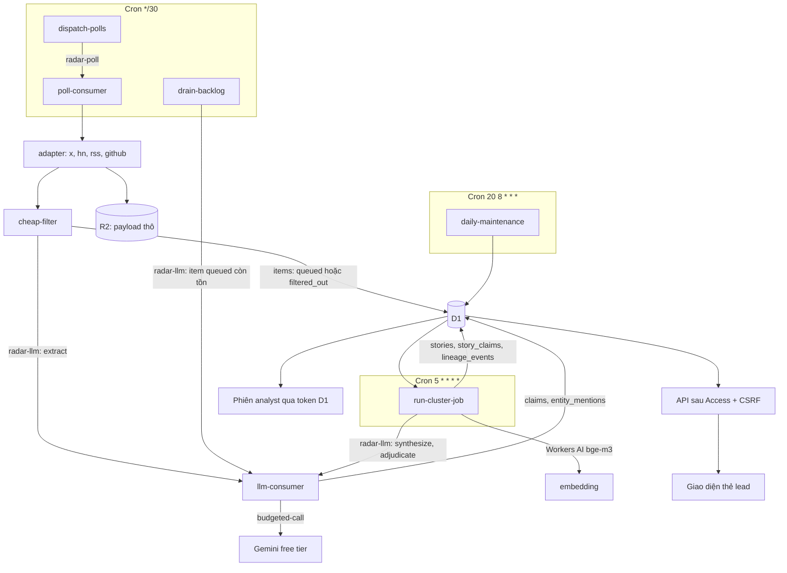

# Kiến trúc

Tài liệu này giải thích hệ thống hoạt động thế nào và vì sao. Chi tiết schema nằm trong [`apps/worker/migrations/`](../apps/worker/migrations/), tham số thuật toán nằm trong [`packages/core/src/params.ts`](../packages/core/src/params.ts); tài liệu này không chép lại chúng.

## Luồng dữ liệu



Một Worker duy nhất xử lý `fetch`, `scheduled` và `queue`, và phục vụ luôn bản build tĩnh của giao diện. Nhờ vậy chỉ có một lần deploy và một hostname để che bằng Access.

## D1 là sổ cái, queue chỉ là tín hiệu đánh thức

Queues giao message ít nhất một lần, chỉ giữ 14 ngày, và message hết hạn thì biến mất chứ không vào dead-letter. Vì vậy không công việc nào chỉ tồn tại trong queue:

- Item mới được ghi **cùng trạng thái cuối của nó** (`queued` kèm `queued_at`, hoặc `filtered_out` kèm lý do) trong một câu lệnh, rồi message mới được gửi. Consumer chết giữa chừng thì item vẫn nằm đó ở trạng thái `queued`.
- Mỗi 30 phút `drain-backlog` gửi lại message cho các item `queued` có lần đánh thức gần nhất quá 30 phút, trong phạm vi ngân sách còn lại của ngày, item trực tiếp trước item backfill. Sau 20 lần thì item thành `failed`.
- Message của item không còn `queued` được ack mà không gọi Gemini. Nhờ đó message giao trùng hay một lô bị phát lại đều vô hại; khoá `(item_id, content_hash)` chặn claim trùng.
- Một nguồn được "thuê" trong D1 (đẩy `next_poll_at` lên 15 phút) trước khi message poll được gửi, nên tick kế tiếp không gửi trùng và message mất thì nguồn tự đến hạn lại.

Lưu ý khi sửa code ghi dữ liệu: dùng `ON CONFLICT (...) DO NOTHING` trên đúng khoá, không dùng `INSERT OR IGNORE`. `OR IGNORE` của SQLite nuốt cả vi phạm `CHECK`, tức một claim sai định dạng sẽ biến mất trong im lặng.

## Ngân sách Gemini

Tài nguyên khan hiếm của free tier là số request mỗi ngày, không phải token. Mười item được gom vào một request bóc claim.

- `budgeted-call` là cửa duy nhất tới Gemini cho cả ba loại việc (`extract`, `synthesize`, `adjudicate`). Nó đặt chỗ trong `llm_usage` trước khi gọi, **xác nhận** khi call đã tính vào quota của Google (200, 429, request bị từ chối) và **hoàn chỗ** khi call không tới nơi (lỗi mạng, 5xx, lỗi vị trí). Không hoàn chỗ thì sổ sách tự cạn trong khi quota thật vẫn còn.
- Dòng sổ được chính câu lệnh đặt chỗ tạo ra theo ngày Pacific, nên sang ngày mới không cần seed gì.
- 20% RPD của mỗi model dành riêng cho tổng hợp và phân xử; bóc claim dùng tối đa 80%, trong đó backfill tối đa 25% tổng RPD. Bước xếp hàng tổng hợp chỉ lên kế hoạch trong phần 20% đó.
- Hết RPM thì chờ 60 giây; hết RPD thì ack message và để item lại trong D1. Gặp 429 thì model bị "đỗ" tới nửa đêm Pacific kế tiếp và call chuyển sang model sau trong chuỗi. Nếu 429 tới ngay sau một lần đặt lại mà hệ thống tin là đã xảy ra, model chỉ bị đỗ thêm một giờ: đó là dấu hiệu giờ đặt lại thật khác giả định.
- Năm lỗi liên tiếp cùng loại không phải hết quota (ví dụ lỗi vị trí) mở ngắt mạch 15 phút.

Ngoại lệ duy nhất đi vòng qua sổ: probe chẩn đoán `gemini` ở `/api/admin/probe`, một request cho mỗi lần gọi tay.

## Claim phải truy nguyên được

Mỗi claim mang một `quote` nguyên văn dài tối đa 300 ký tự. Trước khi lưu, `quote` được so với đúng chuỗi văn bản đã gửi cho Gemini, sau khi chuẩn hoá NFKC, quy các kiểu nháy, gạch và khoảng trắng về một dạng. Nếu không khớp nguyên chuỗi thì thử khớp mờ: ít nhất 90% token xuất hiện đúng thứ tự trong một cửa sổ. Khớp mờ tha cho một từ bị rơi, nhưng **không bao giờ tha cho một con số bị đổi**: mọi token chứa chữ số phải khớp chính xác. Claim bị loại được đếm theo lý do trong `llm_calls.reject_reasons_json`.

Việc bóc claim không tất định, nên mỗi claim ghi `model` và `prompt_version` để truy vết. Tính tất định của hệ thống bắt đầu từ sau bước này.

## Từ claim tới câu chuyện

Node của graph là claim, không phải entity: graph đồng xuất hiện entity sẽ gộp nhầm các sự kiện khác nhau chỉ vì chung một entity lớn.

1. **Gộp entity** theo thang rẻ trước: khớp alias, rồi độ tương tự embedding, và chỉ vùng mơ hồ (cosine 0,75 đến 0,92) mới nhờ Gemini phân xử. Mention mơ hồ nhận ngay một entity tạm để claim của nó vẫn được phân cụm. Tên khác nhau ở dấu hiệu phiên bản ("V4" và "V4.1") không bao giờ tự động gộp.
2. **Cạnh.** Phần cosine (top 30 láng giềng, cosine từ 0,55) bất biến nên được lưu ở `claim_edges`. Phần entity (Jaccard có trọng số IDF, bỏ entity trong danh sách stop và entity trục xuất hiện ở hơn 15% claim) được tính lại **mỗi lần chạy** từ trạng thái gộp entity hiện tại, nên một phán quyết gộp entity có hiệu lực ngay ở lần chạy sau. `weight = 0,6 × cosine + 0,4 × overlap`, giữ cạnh từ 0,45.
3. **Phân cụm** bằng CPM với gamma 0,25 qua `ngraph.leiden`. Hai điều chỉnh đều đến từ phép đo, ghi ở [`spike-results.md`](../plans/260920-0838-content-radar-v1/reports/spike-results.md):
   - Thư viện chạy với `refine: false`, vì pha refinement của nó làm giảm chất lượng phân hoạch. Không có refinement thì đây thực chất là Louvain, nên bảo đảm "cộng đồng liên thông" được khôi phục bằng `splitDisconnected`.
   - CPM giữ cụm theo ngưỡng mật độ, còn trần láng giềng làm một đợt bùng nổ lớn thưa đi, nên CPM cắt một câu chuyện 300 claim thành hàng chục mảnh. `mergeLinkedFragments` nối lại các mảnh theo **độ mạnh liên kết**: cạnh giữa các mảnh của cùng một câu chuyện mạnh ngang cạnh bên trong, còn cạnh keo dính do entity phổ biến chỉ vừa qua ngưỡng.
4. **Cỡ cụm tối thiểu là 2.** Claim lẻ chỉ thành thẻ khi engagement của bài bất thường so với chính tác giả (robust z từ 3).

Thư viện phân cụm nằm sau interface `Clusterer`; thay thư viện chỉ chạm một file.

## Danh tính câu chuyện qua thời gian

`stories` vừa là lineage vừa là thẻ hiển thị, và trạng thái Saved, Dismissed, Written gắn vào `story_id`. Mỗi lần chạy, cộng đồng mới được khớp với **lần xuất hiện gần nhất của mọi câu chuyện còn sống** bằng Jaccard, tính trên phần thành viên **còn nằm trong cửa sổ**. Nếu so trên toàn bộ thành viên, một câu chuyện dài ngày sẽ "chết" giả khi loạt claim đầu tiên ra khỏi cửa sổ cùng lúc.

| Sự kiện | Điều kiện | Ai giữ `story_id` |
|---|---|---|
| `continue` | Jaccard từ 0,5 và là cặp tốt nhất của nhau | Giữ nguyên |
| `split` | Một cũ khớp nhiều mới từ 0,3 | Cụm con lớn nhất |
| `merge` | Nhiều cũ khớp một mới từ 0,3 | Cha lớn nhất; lựa chọn của người dùng trên cha bị nhập được chuyển sang nếu bên thừa kế còn ở inbox |
| `revive` | Không khớp ai đang sống, chữ ký entity khớp từ 0,5 với câu chuyện chết trong 30 ngày | Lấy lại id cũ |
| `birth` | Không thuộc các trường hợp trên | Id mới |
| `death` | Không có kế thừa và lần xuất hiện cuối đã quá 24 giờ | Không còn |

`lookbackHours` là thời gian ân hạn trước khi tuyên bố chết, không phải bộ lọc đầu vào: sau một sự cố dài hơn 24 giờ, các câu chuyện cũ vẫn được khớp hoặc được chôn, không bị bỏ sống cạnh một bản sao mới sinh.

### Công bố nguyên khối

Một lần chạy ghi dở trông giống hệt một cộng đồng bị co lại dưới con mắt của Jaccard. Vì vậy mọi thứ một lần chạy ghi đều gắn `run_id`; câu chuyện mới được chèn dưới dạng bản giữ chỗ vô hình (`alive = 0`) chỉ để lấy id; câu lệnh **cuối cùng** lật `cluster_runs.status` sang `done` và nhả lease. Job chết ở bất kỳ bước nào thì lần chạy sau bỏ qua snapshot đó. Mọi truy vấn đọc lineage đều lọc theo lần chạy `done`.

Khoá chống chạy chồng là một lease lấy bằng một câu lệnh upsert có điều kiện, dài 75 phút và được gia hạn sau mỗi bước.

## Chấm điểm

```
score = 100 × clip(0,30·S_sources + 0,20·S_velocity + 0,15·S_specificity
                  + 0,10·S_counter + 0,15·S_novelty + 0,10·S_recency)
```

- **Nguồn độc lập** là số cặp (tác giả chuẩn, gốc dẫn xuất) phân biệt. Claim trong một bài quote hoặc repost dẫn xuất từ bài gốc, trừ khi nó là trải nghiệm hay đo đạc của chính người viết. Các bài `report` hoặc `announcement` cùng nói về một URL dẫn xuất từ bài sớm nhất. Chỉ **liên kết chính** của item được xét (item có đúng một liên kết ngoài), vì một bài blog thật có thể chứa hàng chục liên kết và việc cùng trích một trang không chứng minh gì. Bình luận Hacker News là tiếng nói độc lập. `READY` khi có từ 2 nguồn độc lập, ngược lại là `LEAD`.
- **Velocity** là robust z của engagement so với median và MAD của chính tác giả (50 bài gần nhất đã đủ 24 giờ tuổi). Bài dưới 24 giờ được quy về mức 24 giờ; bài dưới 3 giờ hoặc tác giả dưới 10 mẫu nhận giá trị trung tính 0,5.
- **Specificity** là tỉ lệ claim có số liệu hoặc là trải nghiệm trực tiếp, không phụ thuộc vai trò do LLM gán.
- **Counter** là 1 khi câu chuyện có claim vai trò `counter`. Đây là thành phần duy nhất của điểm dựa trên phán đoán của Gemini.
- **Novelty** là 1 trừ cosine lớn nhất giữa centroid của câu chuyện và centroid của các câu chuyện sống khác.
- **Recency** giảm một nửa sau mỗi 48 giờ.

Điểm không bao giờ giảm khi thêm một nguồn độc lập (có test tính chất). Mỗi thao tác của người dùng lưu lại điểm và điểm thành phần tại thời điểm đó, làm dữ liệu hiệu chỉnh trọng số về sau.

## LLM làm gì, code làm gì

| Gemini | Code tất định |
|---|---|
| Bóc claim, `text_vi`, `text_en`, `quote`, entity | Kiểm tra `quote` có trong văn bản gốc |
| Headline tiếng Việt, vai trò `evidence` / `context` / `counter`, câu hỏi kiểm chứng | Cạnh, cụm, lineage, quan hệ dẫn xuất, số nguồn độc lập, điểm |
| Phân xử entity mơ hồ | Khớp alias, ngưỡng tự nhận và tự loại, chặn gộp khác phiên bản |

Thẻ không phụ thuộc LLM để hiện ra: mọi câu chuyện có headline dự phòng tất định (claim cụ thể nhất, hoà thì lấy claim sớm nhất) cho tới khi Gemini tổng hợp, và giao diện đánh dấu "chưa tổng hợp". Một câu chuyện chỉ được tổng hợp lại khi thay đổi đáng kể: số nguồn độc lập đổi hoặc từ 30% thành viên là mới, và cách lần trước ít nhất 6 giờ.

Giới hạn của tính tất định: trên cùng tập claim, embedding và tham số đã lưu (`cluster_runs.params_json`), chạy lại với cùng seed cho cùng phân hoạch. Tập claim thì không tái lập được, vì việc bóc claim dùng LLM.

## Bảo mật

- **Mọi request, kể cả static assets, đi qua kiểm tra JWT của Cloudflare Access trong code** (`RS256`, `iss`, `aud`, `exp`, email chủ sở hữu; lỗi tải JWKS thì từ chối) rồi qua lớp chống CSRF (`Sec-Fetch-Site`, `Origin` khớp chính xác, `POST` phải là JSON). Mọi route API nằm trong một bảng route chỉ tới được sau hai lớp này; một test đi qua cả bảng bằng `fetch` thật của Worker. `workers_dev` và preview URL đều tắt.
- **SSRF.** URL từ nội dung crawl bị từ chối nếu là scheme lạ, có thông tin đăng nhập, địa chỉ nội bộ (loopback, RFC1918, link-local, CGNAT, mọi IPv6 literal), hostname không có dấu chấm, `*.workers.dev` hay chính hostname của Worker. Redirect được theo thủ công tối đa 3 bước và kiểm tra lại từng bước; header của người gọi (có thể mang token) chỉ gửi tới host đầu tiên. Body được đếm sau giải nén và huỷ tại trần, nên bom nén không gây hại. Worker không phân giải được DNS nên không chống được DNS rebinding.
- **Prompt injection.** Nội dung crawl tới Gemini trong thẻ dữ liệu, và đầu ra bị ràng buộc bởi schema, chỉ tham chiếu id do hệ thống cấp, và không bao giờ được dùng làm URL, lệnh hay SQL. Bình luận Hacker News được chọn theo thứ hạng của HN, không theo độ dài. Với phiên analyst, cơ chế thật là phạm vi của API token; xem [`analyst-runbook.md`](analyst-runbook.md).
- **Chuỗi cung ứng.** Mọi phiên bản được khoá chính xác, `package-lock.json` được commit, script cài đặt bị tắt. Các gói ít người dùng (`ngraph.leiden`) chỉ được nâng phiên bản kèm đọc diff.
